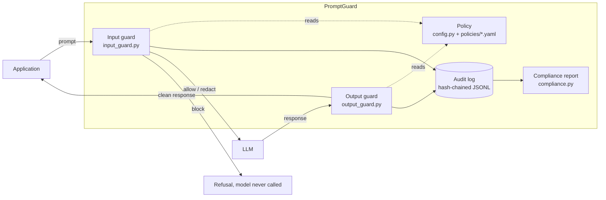
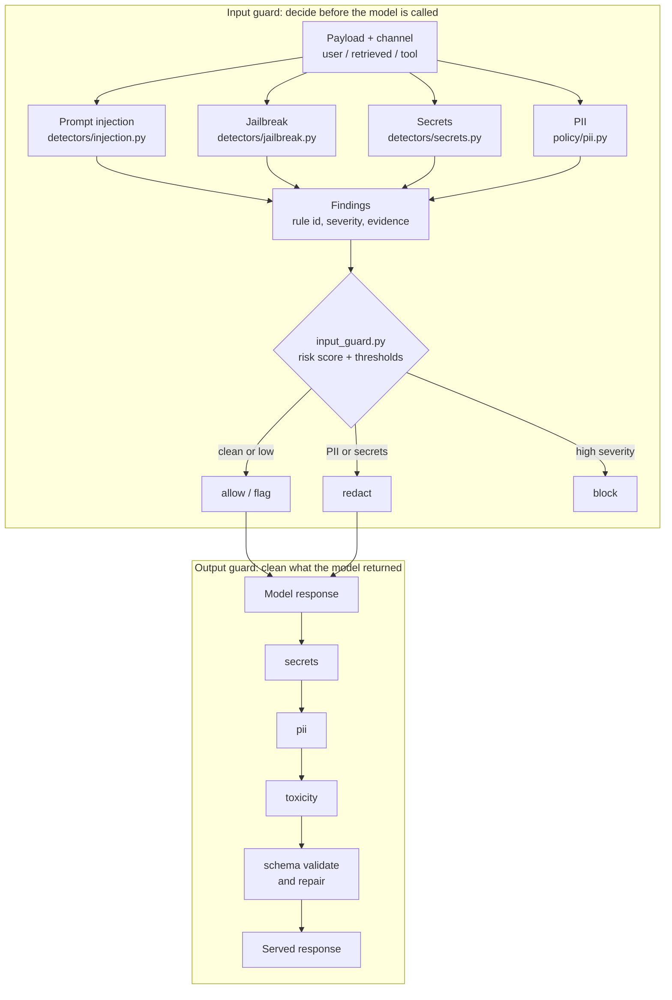

# Architecture and use cases

## System overview

PromptGuard sits between your application and the model. Every request passes an
input guard before the model is called, and every response passes an output
guard before the user sees it. Each decision is written to a hash-chained audit
log and mapped to a control framework.

## Detection pipeline

Input and output are separate pipelines with different jobs.

Output stages run in order inside `policy/engine.py`, and stages can be added,
removed or reordered with `add_stage` and `remove_stage`. Retrieved documents
and tool output are scored more strictly than direct user input, because
indirect injection arrives through those channels.

## Components

| Module | Responsibility |
|---|---|
| `guard.py` | `PromptGuard` facade and correlated sessions |
| `input_guard.py` | Pre-model validation and the allow, redact or block decision |
| `output_guard.py` | Post-model policy: PII leaks, schema validation and repair |
| `detectors/` | Injection, jailbreak and credential rules |
| `policy/` | PII, toxicity, JSON-schema checks and the policy engine |
| `config.py` | Declarative policy, presets (default, strict, permissive), YAML or JSON loading |
| `audit.py` | Append-only, hash-chained decision log with verification |
| `compliance.py` | Maps rule hits to EU AI Act, NIST AI RMF and OWASP LLM controls |
| `server.py` | Optional FastAPI sidecar so non-Python services can call it |
| `cli.py` | `scan`, `redact`, `report`, `verify`, `rules` |

## Use cases

| Use case | Who | How PromptGuard helps |
|---|---|---|
| Stop prompt injection before the model runs | Application developer | `guard.check_input()` blocks "ignore previous instructions" style attacks and never calls the model |
| Protect a RAG system from poisoned documents | RAG or agent builder | Retrieved text is scored as a document channel, so an injected instruction inside a PDF is escalated |
| Keep customer PII out of third-party models | Privacy or security engineer | Card numbers, SSNs and emails are redacted or hashed before the request leaves your boundary |
| Clean model output before display | Product team | The output policy strips emails, phone numbers and card numbers from responses |
| Enforce structured output from an LLM | Backend developer | JSON is validated against a schema and repaired when a markdown fence or trailing comma is the only fault |
| Produce audit evidence for a review | Compliance or risk officer | `promptguard report` summarises findings by control, and `verify` proves the audit chain is intact |
| Add guardrails to a non-Python stack | Platform engineer | Run the FastAPI sidecar and call it over HTTP |
| Gate CI on prompt safety | DevOps | `promptguard scan -f prompts.txt --lines` exits 2 when anything is blocked |
| Tune policy per domain | Domain owner | Swap `default.yaml` for `healthcare.yaml` or write your own, without code changes |
